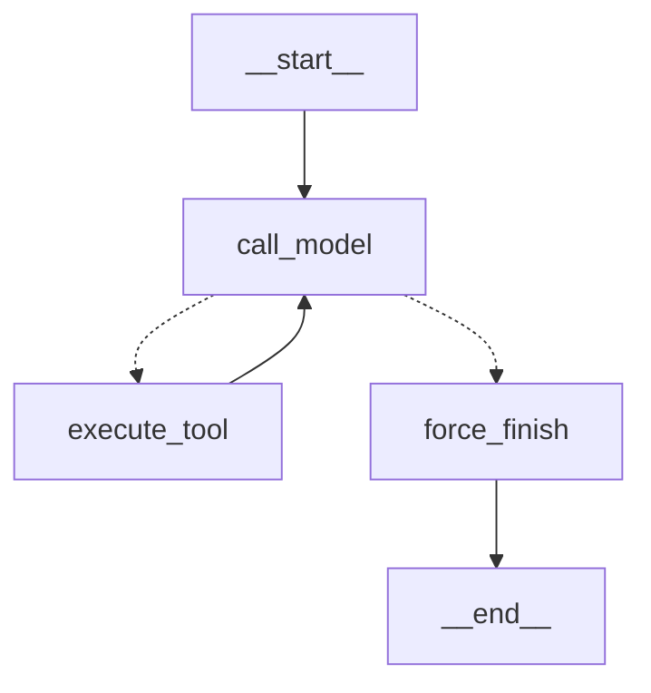

# Homework 6.3 — LangGraph ReAct agent

Historical homework graphs: these custom/prebuilt variants precede the
production Telegram/RAG integration and persistent approval. The final graph
is documented in [final_agent_graph.md](final_agent_graph.md).

## 1. Configuration

The implementation uses `langgraph>=1.0,<2`, `langchain>=1.0,<2`,
`langchain-openai>=1.0,<2` and `langchain-core>=1.0,<2` from
`pyproject.toml` and the committed `uv.lock`.  The model, base URL, timeout and key remain in the
existing environment-based configuration.  The graph module uses a clearly
invalid non-secret placeholder only to permit offline imports when no key is
configured; it cannot make a provider request successfully.

The custom and prebuilt variants share the 6.2 `SYSTEM_PROMPT`, the same
OpenAI-compatible `ChatOpenAI` model and three tool definitions:
`search_knowledge_base`, `get_current_time`, and the local Telegram stub.

## 2. State contract

| Field | Type/reducer | Purpose |
|---|---|---|
| `messages` | `Annotated[list[AnyMessage], add_messages]` | Conversation and tool protocol messages. |
| `iteration_count` | `int`, replace semantics | Number of completed model turns. |
| `tool_results` | `Annotated[list[dict], operator.add]` | JSON-like records of tool output for observation and future checkpoints. |

No SDK client, HTTP session, callback object, API key or other runtime handle
is placed in the state.  LangChain message objects are serializable through
LangGraph's message/checkpoint serializer; `tool_results` is plain JSON data.

## 3. Router and stop conditions

`route_after_model` is a pure deterministic function with the literal output
`"execute_tool" | "force_finish"`:

1. At `iteration_count >= 6`, it selects `force_finish` even if the model asks
   for another tool.
2. Otherwise it selects `execute_tool` only if the last AI message has tool
   calls.
3. Otherwise it selects the explicit `force_finish` node.  This preserves the
   final model answer rather than silently routing directly to `END`.

`execute_tool` never dynamically resolves a function name.  An unknown name
or malformed arguments becomes a model-visible error `ToolMessage`.

## 4. Custom graph Mermaid

The generated source is kept in
[`agent-graph-custom.mmd`](agent-graph-custom.mmd) and is regenerated with
`python scripts/visualize_graph.py`.

The matching prebuilt topology is in
[`agent-graph-prebuilt.mmd`](agent-graph-prebuilt.mmd).

## 5. Benchmark table

The authorized run on 2026-10-21 recorded all 45 combinations (5 cases ×
3 implementations × 3 repeats): 44 completed and one native ReAct iteration
timeout. All variants used the already configured `gpt-6-luna` through
Responses, reasoning `medium`, service tier `priority`. Telegram was a local
stub; search used the historical educational lexical KB, not production RAG.

| Implementation | Completed / attempts | Mean latency, seconds | Observed tokens |
|---|---:|---:|---:|
| Native ReAct 6.2 | 14/15 | 19.81 | 30,068 (lower bound) |
| Custom StateGraph | 15/15 | 14.54 | 16,861 |
| Prebuilt `create_agent` | 15/15 | 14.72 | 16,425 |

Latency includes process startup and failed attempts. Native timeout usage is
incomplete. Completion is not a correctness score: compositional cases 03/04
show partial or irrelevant retrieval in all variants. See the
[dated report](../homework_6_3/BENCHMARK_2026-10-21.md) for budgets, steps,
case-level quality, raw artifact hash and the sanitized 45-row export.

The custom invocation includes
`{"configurable": {"thread_id": "bench-<case>-<repeat>"}}`; with no
checkpointer configured it is a harmless checkpoint-ready identifier.

## 6. Custom vs prebuilt comparison

The custom graph exposes the router, its six-turn ceiling, the exact tool
error policy and state reducers as reviewable application code.  The prebuilt
agent has the smaller implementation surface and delegates its model/tool
cycle to LangChain. In the dated 45-run experiment custom/prebuilt used fewer
observed tokens and had lower mean latency than native with its additional
critic. Native was faster on the no-tool case. Three repeats, different turn
budgets and incomplete native usage do not establish general superiority.

## 7. Real debugging bug

The first custom-graph version bound tools to `ChatOpenAI` but sent only the
state messages to `.ainvoke()`.  That meant the prebuilt graph received
`system_prompt=SYSTEM_PROMPT`, while the custom variant did not — a policy and
safety mismatch that the shared-contract requirement exposed.  The fix inserts
one `SystemMessage(SYSTEM_PROMPT)` at each custom invocation without storing it
in state, so tool-loop iterations do not duplicate it.  The offline test now
asserts that the fake bound model receives the same system prompt; no OpenAI
call was required to find or prove the fix.

## 8. What blocks persistence/checkpointing

The state contract itself is checkpoint-safe, but neither graph is compiled
with a LangGraph checkpointer or durable store.  Therefore a `thread_id` alone
does not retain a conversation across processes, and in-flight tool actions
are not resumable.  Adding persistence needs a deliberate choice of backend,
state retention/PII policy, per-thread authorization and idempotency rules for
side-effecting tools before attaching a checkpointer.
