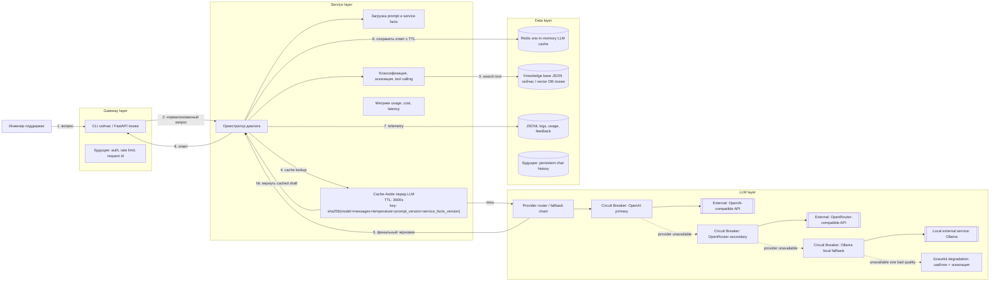

# Архитектурный паспорт Support Copilot

Статус: черновик для домашнего задания 3.2 и следующих модулей.
Последнее обновление: 2026-06-15.

## Область применения

Support Copilot - внутренний ИИ-ассистент для инженеров поддержки MIDAS.
Ассистент помогает искать информацию в базе знаний, готовить черновики ответов,
классифицировать обращения, определять случаи для эскалации и собирать обратную
связь. Он не принимает решения вместо инженера поддержки: финальный ответ
проверяет и отправляет человек.

Текущий пользовательский интерфейс - CLI в пакете `support_copilot`. Следующий
ожидаемый интерфейс - FastAPI с той же сервисной логикой за эндпоинтами
`/chat`, `/chat/stream`, `/health` и `/ready`.

## Архитектура из четырех слоев



Внешние сервисы на схеме отмечены двойной рамкой: OpenAI-compatible API,
OpenRouter-compatible API и Ollama. Redis и будущие хранилища тоже могут быть
внешними сервисами при deployment, но MVP сохраняет возможность offline-тестов
через in-memory cache и локальные JSONL-логи.

## Cache-Aside

За паттерн Cache-Aside отвечает Service layer. Gateway не обращается к кешу
напрямую, а LLM layer не принимает решение о том, можно ли кешировать ответ.

Проверка кеша выполняется до любого платного вызова LLM-провайдера. Если найден
cache hit, сервис возвращает сохраненный черновик. Если произошел cache miss,
сервис вызывает LLM router, валидирует ответ и только потом записывает значение
в кеш.

Состав ключа кеша:

```text
sha256(model + messages + temperature + prompt_version + service_facts_version)
```

TTL по умолчанию: `3600` секунд для обычных FAQ и ответов по документации.

Не кешируем ответы с высокой temperature, персональные данные, инциденты,
ответы с эскалацией и ошибки провайдеров. Целевой cache hit rate для MVP:
`35-45%`.

## ADR-001: паттерн взаимодействия

### Context

Support Copilot сейчас работает как интерактивный CLI, а позже должен стать
небольшим API-сервисом. Большинство запросов короткие: установка, лицензирование,
типовые ошибки, поиск документации, классификация и определение необходимости
эскалации. Инженеру нужен ответ во время обработки обращения, поэтому задержка
важнее максимальной пропускной способности. При этом система должна оставаться
достаточно простой для учебных модулей: prompts, retry/fallback, cache, function
calling, usage tracking и будущие мультимодальные сценарии должны быть видны в
коде, а не скрыты за избыточной инфраструктурой.

### Decision

Выбранный паттерн взаимодействия: **синхронный Request-Response** для основного
support flow. Gateway принимает одно пользовательское сообщение, Service
собирает prompt и tool context, Cache-Aside проверяет наличие переиспользуемого
ответа, LLM layer генерирует черновик, после чего Gateway возвращает результат
инженеру. Streaming остается опциональным вариантом того же паттерна для длинных
ответов и более живого UX. Queue-based processing не входит в MVP chat path.

### Consequences

Архитектура остается простой для локальной отладки и тестирования. Unit-тесты
могут мокать LLM-клиентов и проверять retry, fallback, cache, tool calls и
эскалацию без брокера сообщений. Минус подхода: каждый пользовательский запрос
занимает worker до завершения или ошибки LLM, поэтому gateway timeouts и
provider timeouts должны быть явными. При росте FastAPI сможет использовать ту
же сервисную логику и добавить request id, auth, rate limits и streaming
responses.

### Alternatives

Event-driven queue рассматривалась для всех LLM-вызовов, но она добавляет
операционную сложность и ухудшает интерактивный support-сценарий. Этот подход
лучше оставить для batch evals, индексации документов, аналитики feedback и
медленных мультимодальных задач, а не для первого chat loop.

## ADR-002: отказоустойчивость

### Context

Ассистент зависит от внешних LLM-провайдеров. Они могут возвращать `429`, `5xx`,
timeouts, невалидные ответы или временные всплески latency. Локальная Ollama
полезна как fallback, но на текущем ноутбуке может отсутствовать или работать
слишком медленно на крупных моделях.

### Decision

Основной провайдер: OpenAI-compatible cloud model из `.env`.

Fallback chain:

```text
OpenAI primary -> OpenRouter/OpenAI-compatible secondary -> local Ollama -> template + escalation
```

У каждого провайдера свой Circuit Breaker. Retry разрешен только для `429`,
`5xx` и timeout с exponential backoff + jitter. Не повторяем `400`, `401` и
`403`, потому что это ошибки конфигурации, авторизации или контракта запроса.
Если все провайдеры недоступны, сервис возвращает понятный graceful-degradation
ответ и предлагает эскалацию человеку.

### Consequences

Пользователь получает полезный ответ даже при отказе основного провайдера.
Компромисс: fallback-ответы могут отличаться качеством, latency и стоимостью.
Поэтому каждый ответ провайдера нужно логировать с model, latency, token usage и
fallback reason. Состояние Circuit Breaker стоит показывать в `/stats` или в
будущих observability endpoints.

## Возможные точки отказа

| Слой | Что может сломаться | Паттерн защиты | Graceful degradation |
| --- | --- | --- | --- |
| Gateway | Неверная команда, слишком длинный ввод, disconnect клиента, будущая ошибка auth/rate-limit | Input validation, size limit, request id, понятные ошибки, timeout | Попросить сократить запрос или повторить; CLI продолжает работать |
| Service | Потерян prompt-файл, несовпадение tool schema, ошибка классификатора, плохой JSON от модели, prompt injection | Версионированные prompts, строгие output contracts, schema validation, injection rules, unit tests | Вернуть безопасный support-ответ; эскалировать при неуверенной классификации |
| LLM | `429`, `5xx`, timeout, outage провайдера, переполнение context window, слабое качество fallback | Retry with backoff, Circuit Breaker на провайдера, fallback chain, context window trimming | Переключиться на другого провайдера; если все отказали, вернуть шаблон и рекомендовать эскалацию |
| Data | Недоступен cache, stale cache, не найдена база знаний, ошибка записи лога, будущий DB outage | Cache-aside with bypass, TTL, versioned cache key, optional Redis, local fallback logs | Продолжить без кеша; ответить по prompt/service facts; предупредить, что данные поиска могут быть неполными |

## Нагрузка и бюджет

Начальные assumptions для MVP:

| Метрика | Цель / допущение |
| --- | --- |
| Активные инженеры поддержки | 5 |
| Запросов на инженера в день | 60 |
| Среднее число запросов в день | 300 |
| Peak RPM | 30 сейчас, до 50 после API rollout |
| Средний input size | 900 tokens |
| Средний answer size | 250-450 tokens |
| Средний total tokens per request | 1,250 tokens |
| Peak TPM при 30 RPM | около 37,500 TPM |
| Daily token volume before cache | около 375,000 tokens |
| Target cache hit rate | 35-45% |
| Daily token volume after 40% cache hit | около 225,000 billable tokens |
| MVP budget guardrail | не больше 5 USD/day для обычного support-трафика |
| Latency target | первый полезный текст до 1.5 секунды в streaming real mode; полный ответ до 8 секунд для обычных запросов |

Точные model id, цены и лимиты намеренно не захардкожены в этом документе.
Перед production-выбором модели нужно проверить актуальную документацию
провайдера и обновить `.env.example`, а не бизнес-логику.

## LiteLLM

LiteLLM рассматривается как кандидат на LLM gateway, но не является обязательной
runtime-зависимостью для текущего CLI. По официальной документации LiteLLM Proxy
настраивается через `config.yaml`, может читать секреты из environment
variables, предоставляет OpenAI-compatible API и поддерживает routing strategies,
retries, fallbacks, timeouts и cooldowns.

Подготовленный конфиг:

```text
docs/litellm/config.yaml
```

Команды для локального эксперимента:

```powershell
python -m pip install "litellm[proxy]"
litellm --config docs/litellm/config.yaml --detailed_debug
```

Пример запроса:

```powershell
Invoke-RestMethod `
  -Uri "http://localhost:4000/v1/chat/completions" `
  -Method Post `
  -Headers @{ Authorization = "Bearer $env:LITELLM_MASTER_KEY" } `
  -ContentType "application/json" `
  -Body '{"model":"support-copilot-primary","messages":[{"role":"user","content":"Как исправить ошибку лицензии?"}]}'
```

Симуляция отказа primary provider:

```powershell
$env:OPENAI_API_KEY = "invalid-key-for-fallback-test"
litellm --config docs/litellm/config.yaml --detailed_debug
```

После этого нужно отправить тот же запрос и проверить, что proxy пытается пройти
по fallback chain. Для полноценного успешного fallback-теста secondary provider
или local Ollama должны быть настроены валидными credentials/runtime.

Решение для текущего MVP: **пишем и оставляем собственный lightweight
OpenAI-compatible client** в `support_copilot/infrastructure`, а CLI пока не
проводим через LiteLLM. Причина: задания курса требуют явной локальной
реализации retry, fallback, cache, usage tracking и Function Calling. LiteLLM
становится полезным, когда проект переходит от одного CLI к общему API gateway
для нескольких клиентов, команд, провайдеров, virtual keys, budgets и admin
observability.

Источники для раздела LiteLLM:

- https://docs.litellm.ai/docs/proxy/configs
- https://docs.litellm.ai/docs/routing
- https://github.com/BerriAI/litellm
