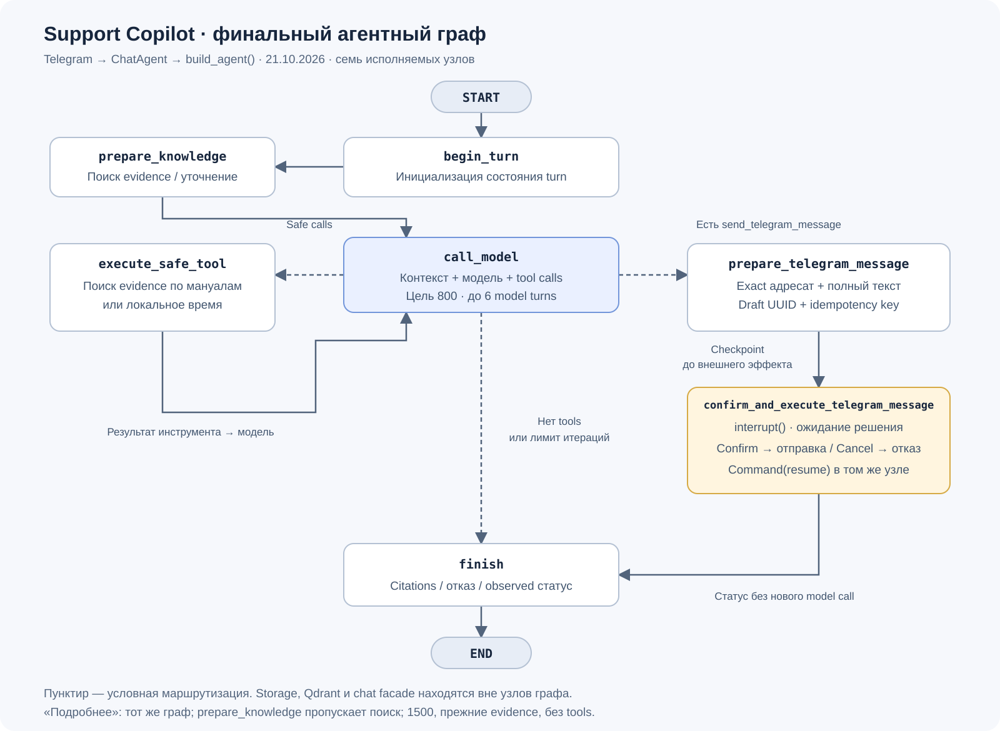

# Финальный агентный граф Support Copilot

Актуален для принятой версии 21.10.2026; общий retrieval-first путь развёрнут.
[Приёмка и границы качества](final_acceptance.md). Источник —
`build_agent()` в [app/services/agent_persistent.py](../app/services/agent_persistent.py).
Граф использует `ChatAgent` через существующий `/chats` facade.



Отдельные файлы: [SVG для сдачи](final-agent-graph.svg),
[Mermaid из runtime graph](final-agent-graph.mmd).
SVG снабжён пояснениями; полный перечень узлов и рёбер получен из
`build_agent(InMemorySaver(), model=object()).get_graph().draw_mermaid()`
без LLM/Telegram-вызовов и без открытия production saver.

## Узлы и условия перехода

| Узел | Что происходит | Следующий шаг |
|---|---|---|
| `begin_turn` | Сброс счётчика, draft и состояния нового turn; expanded сохраняет evidence | `prepare_knowledge` |
| `prepare_knowledge` | Для документации: общий retrieval и исходный пакет до 12К символов; до 6К зарезервировано для прицельных дополнений. Неопределённый первый вопрос о параметрах получает локальное уточнение; редактура, smalltalk, действия и expanded пропускают поиск | `call_model` |
| `call_model` | Для локального уточнения пропускает LLM. Иначе bounded context, token budget, инструкция и обработка неполного ответа; возможны дополнительные поиски. Expanded использует `tool_choice=none` | Safe tools → `execute_safe_tool`; есть отправка → `prepare_telegram_message`; нет tools или достигнуто 6 model turns → `finish` |
| `execute_safe_tool` | Последовательное выполнение/отклонение safe calls; каждому соответствует `ToolMessage` | `call_model` |
| `prepare_telegram_message` | Обработка safe calls смешанного batch, отклонение лишних отправок; валидация и сохранение exact draft с UUID/key | `confirm_and_execute_telegram_message` |
| `confirm_and_execute_telegram_message` | Проверка роли; `interrupt()`; после resume подтверждение/отмена и observed delivery result | `finish` |
| `finish` | Grounding citations или канонический отказ/статус; на лимите закрытие pending tool calls | `END` |

`START → begin_turn` начинает новый turn. После safe tool есть возврат к модели;
после approve/cancel такого возврата нет. Невалидный draft проходит узел
подтверждения без interrupt и без отправки. `read-only` получает отказ;
административная `full` может обходить interrupt только в raw agent API.
Telegram всегда использует `write-with-approve`.

## Инструменты и внешние границы

- `search_knowledge_base` вызывает injected `RAGService.retrieve` по production
  корпусу мануалов в Qdrant. Возвращает evidence, identities/pages и статус,
  а не готовый ответ. Синтетическая JSON-база не используется.
- `get_current_time` выполняет локальное вычисление времени.
- `send_telegram_message` является запросом действия: его tool body напрямую
  не исполняется. Side effect вызывает injected notifier только внутри узла
  подтверждения, используя сохранённый idempotency key.

FastAPI auth, ownership, moderation, shared chat lock, persistence истории и
Telegram rendering находятся **вне** этих семи узлов. Checkpointer сохраняет
состояние/ожидающий interrupt; Qdrant хранит evidence. Эти сервисы не следует
рисовать дополнительными LangGraph-узлами.

## Interrupt / resume

1. `prepare_telegram_message` сохраняет `chat_id`, полный `text`, `tool_call_id`,
   `approval_id` и `idempotency_key` без отправки.
2. Узел подтверждения вызывает `interrupt()`; preview возвращается через chat
   facade, бот показывает «Подтвердить» / «Отменить». Ожидание переживает
   перезапуск с SQLite/PostgreSQL saver.
3. API проверяет owner + chat + exact draft UUID под общим turn lock.
   `Command(resume=approved)` продолжает **тот же узел**, а не начинает новый
   путь через `START`. Callback не может заменить адресата или текст.
4. Approve вызывает notifier; Cancel не имеет эффекта доставки. `finish`
   возвращает наблюдаемый статус без следующего model call. Старый/чужой/повторный
   callback отклоняется; при неизвестном исходе нужна проверка у получателя.

## «Подробнее» на том же графе

Expansion не добавляет узлов. Chat facade проверяет явное согласие и актуальный
assistant UUID, сохраняет one-use claim **до** платного вызова и запускает
тот же `START → begin_turn → prepare_knowledge → call_model → finish → END` с `expanded_mode=true`.
Узел `prepare_knowledge` в этом режиме ничего не извлекает.
Используются прежние evidence, целевой размер видимого ответа 1500 токенов
и `tool_choice=none`.
Неожиданные tool calls удаляются/отклоняются, новый поиск и отправка недоступны.
Preview/отмена expansion не запускают граф и модель. Целевой размер обычного
ответа — 800 токенов; автоматического LLM repair нет. При reasoning общий
provider cap дополнительно включает резерв 8192 токена; отдельный жёсткий
потолок видимого текста не гарантируется.

## Воспроизведение схемы

Из `HelpDesk_Assistant/`:

```powershell
.venv/Scripts/python.exe -X utf8 scripts/visualize_final_agent_graph.py
```

Команда обновляет только `docs/final-agent-graph.mmd`, не открывает рабочие
checkpoints и не вызывает провайдера. При изменении runtime graph нужно
согласовать с новым Mermaid также SVG, эту таблицу и итоговое описание.
Учебные `agent-graph-custom.mmd`, `agent-graph-prebuilt.mmd` и
`architecture-multi-agent.md` к этой схеме не относятся.
