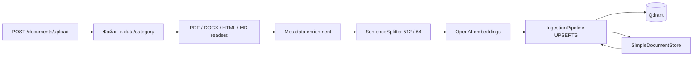
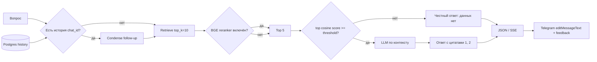

# Корпоративный RAG-ассистент Support Copilot

## Архитектура ingestion



`app/services/ingestion.py` поддерживает PDF, DOCX, HTML, Markdown, TXT и CHM.
Для PDF используется `PyMuPDFReader`, для DOCX — `DocxReader`, для HTML —
`HTMLTagReader`, для Markdown — `MarkdownReader`. Ошибка одного файла не
останавливает пакет: файл получает суффикс `.failed`, а путь попадает в итоговую
статистику и лог.

Каждый документ получает метаданные:

- `source` и `file_name` — имя исходного файла;
- `file_path` — нормализованный путь;
- `last_modified` и `created_at` — время из файловой системы;
- `author` — автор из DOCX core properties, если заполнен;
- `category` — первый каталог после `data/`;
- `version` — версия вида `v2`, `2.1` или дата из имени файла.

Технические поля пути и времени остаются доступными для фильтров и цитат, но
исключены из embedding через `excluded_embed_metadata_keys`. Детерминированный
document id и сохранённый `SimpleDocumentStore` позволяют
`DocstoreStrategy.UPSERTS` переиндексировать только изменившиеся документы.
Коллекция при старте приложения не удаляется.

## Архитектура query и диалога



Retrieval и генерация разделены: сначала выбираются 10 кандидатов, затем
опциональный `BAAI/bge-reranker-v2-m3` оставляет 5, после чего код проверяет
максимальный cosine score. При низком score LLM не вызывается. Это дополняет
системный prompt, который запрещает отвечать вне переданного контекста.

Для короткого follow-up RAG объединяет последний пользовательский вопрос с
уточнением. Поэтому пара «Каков срок возврата?» → «А для электроники?» идёт в
retrieval как самостоятельный запрос, а полная история ответа по-прежнему
хранится в Postgres.

## Параметры Б5.4 и confidence threshold

| Параметр | Значение |
|---|---|
| Chunking | `recursive` / `SentenceSplitter` |
| `chunk_size` | `512` токенов |
| `chunk_overlap` | `64` токена |
| Retrieval | `top_k=10` |
| Re-ranker | optional `BAAI/bge-reranker-v2-m3`, `top_n=5` |
| Embedding | `text-embedding-3-large`, 1024 dimensions, cosine |
| `rag_score_threshold` | `0.45` |

Значение `0.3` из задания является стартовым ориентиром для
`text-embedding-3-small`. В проекте сохранена выбранная в Б5.1 модель
`text-embedding-3-large` с 1024 измерениями. На прогоне Б5.3 релевантные top-1
результаты начинались примерно с `0.611`, а запрос о несуществующих цене и SLA
получал `0.403`. Поэтому для текущего корпуса выбран начальный порог `0.45`: он
отсекает наблюдавшийся out-of-domain результат и сохраняет запас до минимального
наблюдавшегося релевантного score. Порог задаётся через
`RAG_SCORE_THRESHOLD` и должен повторно калиброваться на golden-наборе после
смены модели или корпуса.

`sentence-transformers` вынесен в `requirements-reranker.txt`: при
`RAG_RERANKER_ENABLED=false` Docker не загружает многогигабайтный CUDA/PyTorch
стек. Если включить переменную, тот же `docker compose up -d --build`
автоматически добавит re-ranker в образ без ручного `pip install`.

## Корпус и воспроизводимость

Фактическая разбивка находится в `docs/data_inventory.md`. Корпус содержит 70
исходных файлов: 9 PDF, 60 безопасных HTML-разделов, извлечённых из реальной
CHM-справки, и исходный CHM. Общий размер индексируемых файлов — 82 110 308
байт. Это превышает требования 30 документов и checkpoint 50+.

Офлайн-подготовка корпуса без сети:

```powershell
python scripts/download_data.py --from-chm "data/rag-block-03/GTS_NX 2021.chm" --output-dir data/gts_nx_help_html --limit 60
```

Полностью локальная проверка ingestion:

```powershell
python scripts/ingest.py data/ --offline-smoke --collection homework_5_5_offline --dimensions 64 --docstore-path var/homework_5_5_docstore.json --offline-qdrant-path var/homework_5_5_qdrant
```

На первом прогоне 10 сентября 2026 года получено `1992 changed`, 3508 чанков,
ошибок нет. Повторный запуск дал `0 changed, 1992 unchanged, 0 failed` и не
создал новых чанков.

Для OpenAI ingestion нужно осознанно установить
`RAG_ALLOW_EXTERNAL_DATA_TRANSFER=true`; без этого документы не отправляются
внешнему провайдеру. Если embedding-провайдер недоступен, API продолжает
работать, а `/rag/query` отвечает `503 rag_unavailable`: внешний сбой не
запускает бесконечный restart loop всего приложения.

## HTTP и Telegram

| Endpoint | Назначение |
|---|---|
| `POST /rag/query` | Синхронный вопрос; optional history; ответ и sources |
| `POST /chats/{id}/messages` | Диалоговый SSE: token, message, `event: sources`, done |
| `POST /documents/upload` | PDF/DOCX/HTML/MD, сохранение в `data/`, ответ 202 и background UPSERT |
| `POST /chats/{id}/messages/{mid}/feedback` | Оценка `up/down` вместе с показанными sources |

Объект источника имеет поля `id`, `file_name`, `page`, `score`, `snippet` и
`confident`. Ответ использует нумерованные ссылки `[1]`, `[2]`. SSE-токены
сериализуются JSON, поэтому переносы строк не разрывают событие; массив
источников отправляется отдельным финальным `event: sources` после legacy-маркера
`done`.

Telegram-бот читает этот же endpoint, создаёт одно сообщение и обновляет его
через `editMessageText` с debounce 0.8 секунды, а после ответа показывает footer
с именами файлов и страницами. Финальная версия сообщения использует безопасный
Telegram HTML: `**жирный текст**` превращается в bold, а `` `код` `` — в inline
code; текст и имена файлов перед этим экранируются. Кнопки 👍/👎 сохраняют не
только голос, но и показанный пользователю массив источников.

## Запуск

```powershell
Copy-Item .env.example .env
# заполнить OPENAI_API_KEY, TELEGRAM_BOT_TOKEN, INTERNAL_TOKEN,
# QDRANT_API_KEY и после согласования включить RAG_ENABLED и transfer opt-in
docker compose up -d --build
```

Если коллекция уже заполнена (например, после отдельного запуска
`scripts/ingest.py`), в `.env` укажите:

```dotenv
RAG_ENABLED=true
RAG_INGEST_ON_START=false
```

Тогда приложение подключится к существующей `RAG_COLLECTION` без чтения
корпуса и без отправки фрагментов документов в embedding-провайдер на старте.

Compose поднимает `app`, `qdrant`, `redis`, `bot`, а также уже используемые
Postgres и Phoenix. `data/`, docstore и Qdrant/Postgres/Redis volumes
персистентны; ручные `docker exec` и `pip install` не нужны.
