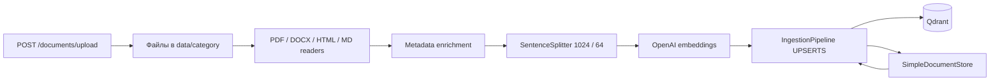

# Корпоративный RAG-ассистент Support Copilot

## Архитектура ingestion



`app/services/ingestion.py` поддерживает PDF, DOCX, HTML, Markdown, TXT и CHM.
Для PDF используется pypdf-backed `PDFReader`, для DOCX — `DocxReader`, для HTML —
`HTMLTagReader`, для Markdown — `MarkdownReader`. Ошибка одного файла не
останавливает пакет: файл получает суффикс `.failed`, а путь попадает в итоговую
статистику и лог.

Каждый документ получает метаданные:

- `source` и `file_name` — имя исходного файла;
- `file_path` — нормализованный путь;
- `last_modified` и `created_at` — время из файловой системы;
- `author` — автор из DOCX core properties, если заполнен;
- `category` — первый каталог после `data/`;
- `product` — канонический продукт (`gts_nx`, `civil`, `fea_nx`, `gen`,
  `soilworks` и другие `midas <имя>` через общий маркер);
- `page` и `total_pages` — физическая 1-based страница PDF и число страниц;
- `version` — версия вида `v2`, `2.1` или дата из имени файла.

Продукт определяется по маркерам в пути и имени, а не по списку отдельных
файлов. Явные `midas Civil`, `FEA NX`, `SoilWorks` и другие известные маркеры
имеют приоритет; нейтральные имена вроде `User Manual_Chapter5` наследуют
продукт корпуса из `RAG_PRODUCT` (по умолчанию `gts_nx`). Значения `all`,
`any`, `none` зарезервированы под управление областью поиска и отклоняются
как `RAG_PRODUCT`: область настраивается отдельной `RAG_PRODUCT_SCOPE`.

Технические поля пути и времени остаются доступными для фильтров и цитат, но
исключены из embedding через `excluded_embed_metadata_keys`. Детерминированный
document id и сохранённый `SimpleDocumentStore` позволяют
`DocstoreStrategy.UPSERTS` переиндексировать только изменившиеся документы.
Коллекция при старте приложения не удаляется.

## Архитектура query и диалога

```mermaid
flowchart LR
    Q[Вопрос] --> H{Есть история chat_id?}
    PG[(Postgres history)] --> H
    H -->|LLM condense: resolved или echo| C[Один standalone запрос]
    H -->|нет| R[До 30 raw candidates]
    H -->|condense недоступен + follow-up| C2[Exact + history-expanded variants]
    C --> F[RRF merge полного union]
    C2 --> F
    H --> FT[Строгий full-text recall]
    FT --> F
    F --> PF
    R --> PF[Product scope: сначала RAG_PRODUCT]
    PF --> V[Dense + lexical ranking полного union]
    V --> PS{Есть evidence в scope?}
    PS -->|да| K[Максимум 30 кандидатов]
    PS -->|нет, scope=fallback| FB[Тот же отбор по всему корпусу]
    FB --> K
    K --> X{BGE reranker включён?}
    X -->|да| N[BGE ordering всего пула]
    X -->|нет| U
    N --> U[Deduplicate и максимум 5 context fragments]
    U --> G{cosine >= threshold или strict lexical evidence?}
    G -->|нет| D[Честный ответ: данных нет]
    G -->|да| L[LLM по контексту]
    L --> A[Проверка и перенумерация цитат]
    D --> O[JSON / SSE]
    A --> O
    O --> T[Telegram editMessageText + feedback]
```



Retrieval и генерация разделены. `RAG_TOP_K=10` задаёт базовый размер dense-поиска, а
retriever запрашивает до `min(30, top_k * 3)` **raw candidates**. Самостоятельный
вопрос выполняет один поиск. При наличии истории диалога вопрос сначала
проходит LLM-condense (`build_llm_condense_hook`, инжектится при сборке
приложения, `RAG_CONDENSE_LLM_ENABLED=true`): модель переписывает
контекстно-зависимый ход в один самостоятельный поисковый вопрос, разрешая
отсылки («из них», «этот параметр») по ограниченному блоку диалога, а уже
самостоятельный вопрос возвращает без изменений — оба исхода идут одним
dense-запросом (`plan_mode` = `condense_hook` или `independent`). Если
LLM-condense выключен, упал или нарушил контракт вывода (одна строка ≤ 500
символов), включается детерминированный fallback: явно зависимый follow-up
(анафорическая ссылка вроде «из них» либо короткое разговорное уточнение)
выполняет два запроса — точную формулировку пользователя для recall и
объединённую с последним обменом формулировку для disambiguation. После product filter результаты объединяются
по node id через reciprocal-rank fusion (RRF, стандартная rank-константа 60).
К dense-кандидатам добавляется строгий полнотекстовый recall по Qdrant payload
index. Для самостоятельного вопроса используются до четырёх информативных слов;
для LLM-condensed и явного standalone запроса — термины уже разрешённой
формулировки; для heuristic follow-up — слова текущего ограничения и первые
два слова предмета прошлого вопроса. Разговорные вводные («расскажи мне про», «объясни», `tell me about`)
не входят в строгий запрос; самостоятельное составное название может состоять
из двух достаточно специфичных терминов. Если неизвестная вводная или фраза
после названия всё же попала в строгий запрос и не дала результатов, поиск
пробует ограниченный набор двух- и трёхсловных окон от краёв к центру. При
опечатке и слабом исходном dense score те же окна используются как ограниченный
dense-fallback. Все слова должны встретиться в одном фрагменте, а русский snowball
stemmer согласует падежи. Поэтому запрос «плоская деформация + степени свободы»
находит нужный раздел, даже если его нет в dense top-30. Один лучший lexical
match резервируется в пятифрагментном контексте, остальные места сохраняются
за dense-поиском. При сортировке lexical matches приоритет имеет совпадение
всех терминов в компактном фрагменте и текущего ограничения в начале страницы:
позднее случайное упоминание внутри соседнего раздела не вытесняет прямое определение.
Для зарезервированного lexical match в prompt передаётся локальное окно вокруг
самого компактного совпадения, а не вся PDF-страница; это не даёт соседнему
подразделу подменить запрошенное свойство. Если lexical match зарезервирован
в зависимом follow-up, контекст ограничивается тремя фрагментами: резерв
остаётся первым, а до двух сильнейших кандидатов сохраняются как
альтернатива — ошибочное all-token попадание не остаётся единственным
источником генератора.
Payload-index создаётся online один раз, без пересчёта vectors.

Продуктовая область поиска задаётся двумя настройками. `RAG_PRODUCT` — основной
продукт корпуса (`gts_nx`): он же используется как product-тег для файлов без
явных маркеров. `RAG_PRODUCT_SCOPE` управляет фильтрацией при ответе:
`strict` оставляет только фрагменты основного продукта (поведение ранних
версий), `all` снимает фильтр полностью, а `fallback` (значение по умолчанию)
сначала прогоняет scoped-пул и только если он не проходит gate — нет
кандидата с `top_score >= RAG_SCORE_THRESHOLD` и нет выжившего strict-lexical
match — повторяет тот же отбор по уже полученному полному корпусу без
дополнительных retrieval-запросов. Поэтому явно помеченные документы других
продуктов (например, уже лежащее в корпусе «Руководство по расчетам midas
Civil 2020.pdf») остаются достижимыми и отвечают на вопросы вне основного
продукта, но никогда не вытесняют evidence основного продукта, когда оно
есть. Телеметрия `rag_retrieval_completed` фиксирует фактическую область
(`product_scope`: `primary`, `fallback_all`, `all`) и число выбранных
фрагментов вне основного продукта (`cross_product_selected_count`).

Широкие обзорные вопросы (`расскажи про`, `что такое`, `дай обзор`) получают не
более трёх фрагментов контекста, не более одного на исходный файл. Генератор сначала формулирует определение,
объединяет не более трёх основных аспектов и не пересказывает узкие настройки
из каждого найденного раздела. Если фрагменты относятся к разным типам расчёта,
ответ кратко классифицирует их и запрашивает уточнение сценария.

Lexical evidence ранжирует полный union (до 90 уникальных фрагментов), и только
после этого пул ограничивается 30 кандидатами. Поэтому точный фрагмент из одного
варианта не теряется за дублями, найденными обоими запросами. Dense scores разных вариантов не
смешиваются как сопоставимые величины; лучший исходный cosine score сохраняется
для confidence. Явный `standalone_question`, LLM-condensed rewrite и custom
condense hook остаются одиночными запросами. После fusion действует прежнее dense + lexical
ранжирование: `rank = cosine + TERM·term_coverage + PAIR·pair_coverage`, где
`term_coverage` — доля информативных терминов запроса во фрагменте, а
`pair_coverage` — доля покрытых соседних пар терминов. Веса настраиваются через
`RAG_LEXICAL_TERM_WEIGHT` (по умолчанию `0.7`) и `RAG_LEXICAL_PAIR_WEIGHT` (по
умолчанию `0.3`); значения подобраны на eval-наборе, а `0`/`0` полностью
отключает lexical-буст и возвращает чистый dense-порядок.
Если включён BGE re-ranker, он также получает весь отфильтрованный пул и
возвращает его полное упорядочивание. Только после ранжирования
удаляются точные и близкие дубли и применяется финальный лимит — не более пяти
**context fragments** для LLM (или меньше, если задан меньший
`RAG_RERANKER_TOP_N`). Жёсткого лимита на число фрагментов одного документа
нет: он не должен выбрасывать точное доказательство. Поэтому число документов
в Telegram, число контекстных фрагментов и внутреннее число raw candidates —
разные величины. При низком score LLM не вызывается.

В generation prompt передаётся **полный текст каждого из выбранных пяти
фрагментов**. Поле `snippet` ограничено 700 символами только для компактного
API/SSE-предпросмотра и сохранения в Telegram-источниках; оно не участвует в
построении prompt. Это сохраняет конец длинной страницы PDF, если точное
перечисление начинается после заголовка и вводного текста.

Follow-up распознаётся по маркерам продолжения в первом токене («а», «и»,
«но», «или», «если», «значит», «подробнее», «например», «уточни» и
EN-аналоги), многословным открытиям («то есть», «что насчёт», «what about»),
однословным продолжениям («почему», «дальше», «ещё»), коротким предложным
фрагментам до четырёх токенов («для 2D?», «у него?») и анафоре: короткие
вопросы с местоимением, wh-вопросы со ссылкой в первых позициях («как мне
настроить этот параметр?») и вопросы до восьми токенов, открытые анафорой
(«этот метод применяется для…?»). Ведущие дискурсивные частицы («ну»,
«ладно», «вот») перед проверкой срезаются. Самостоятельные технические
вопросы с поздним местоимением («какие параметры элемента влияют на его
жёсткость?») остаются независимыми: ложноположительная детекция добавляет
лишь один ограниченный вариант запроса, ложноотрицательная теряет тему.

В fallback-режиме (LLM-condense выключен или не дал валидного ответа) для
follow-up RAG строит самостоятельный запрос без synthetic labels вида
«контекст предыдущего вопроса»: он соединяет последний обмен — вопрос
пользователя и ответ ассистента (каждый до 400 символов; цитаты `[N]` и
абстенции `NO_ANSWER` вырезаются) — с уточнением. Например, пара «Какие
степени свободы используются…?» → «А какие из них используются для плоской
деформации?» остаётся одной понятной темой для ranking, а referent «них»,
введённый именно ответом ассистента, тоже попадает в запрос. Параллельно
исходное уточнение используется как второй, retrieval-only запрос для
recall; это помогает найти узкий раздел, когда ссылка «из них» сама по себе
плохо кодирует тему. Полная история ответа по-прежнему хранится в Postgres.

Generation prompt дополнительно содержит ограниченный блок `Диалог:` —
последние шесть сообщений истории (до 600 символов каждое) с ролями
`Пользователь:`/`Ассистент:`, размещённый между system prompt и `Контекст:`.
Он позволяет генератору разрешать эллиптические follow-up («а какие из них?»)
по реальным ходам диалога, а не только по retrieval-запросу. Цитаты `[N]`
из прошлых ответов ассистента вырезаются: они относятся к старой нумерации
фрагментов и не должны смешиваться с источниками текущего ответа.

После generation принимаются только ссылки на существующие номера контекста.
Перед проверкой альтернативные формы цитирования — `【1】`/`【1†…】`, `[^1]`,
«источник 1»/«sources 1 и 2», а при полном отсутствии канонических маркеров
и mid-line `(1)` — нормализуются к `[N]`. Если валидных ссылок всё равно нет,
ответ доставляется без списка источников (висячие `[N]` вне диапазона
вырезаются), а не маскируется под нехватку сведений: промпт уже ограничивает
генерацию контекстом, а отказ делал корректные ответы неотличимыми от пустого
retrieval. API/SSE, сохранённое сообщение и Telegram получают только
процитированные фрагменты; после фильтрации ссылки
перенумеровываются, поэтому `sources[N-1]` всегда соответствует `[N]`.
Если модель сообщает, что в базе или предоставленном контексте нет сведений,
ответ нормализуется к единой фразе отказа, а случайно добавленные ссылки и
источники удаляются.

Событие `rag_retrieval_completed` записывает hash вопроса (без его текста),
режим planner, размеры raw/product/lexical/fused/ranked пулов, выбранные node id, top cosine
score, retrieval latency, outcome и число процитированных источников. Это
отделяет провал candidate recall от ranking, confidence и citation validation,
не помещая пользовательский вопрос или текст документов в лог.

## Параметры Б5.4 и confidence threshold

| Параметр | Значение |
|---|---|
| Chunking | `recursive` / `SentenceSplitter` |
| `chunk_size` | `1024` токена |
| `chunk_overlap` | `64` токена |
| Raw retrieval | 1 запрос; 2 только для зависимого follow-up, по 30 кандидатов |
| Hybrid recall | strict full-text match, до 30 кандидатов; 1 reserved context slot |
| Query fusion | deterministic RRF по node id; lexical selection полного union; лимит 30 после неё |
| Product scope | `RAG_PRODUCT=gts_nx`; `RAG_PRODUCT_SCOPE=fallback` (strict \| fallback \| all) |
| Ranking | cosine + `RAG_LEXICAL_TERM_WEIGHT`·term_cov + `RAG_LEXICAL_PAIR_WEIGHT`·pair_cov (0.7/0.3); затем optional BGE |
| Context | максимум 5 уникальных фрагментов без жёсткого лимита на документ |
| Re-ranker | optional `BAAI/bge-reranker-v2-m3`, `top_n=5` |
| Embedding | `text-embedding-3-large`, 1024 dimensions, cosine |
| `rag_score_threshold` | `0.45` |

Значение `0.3` из задания является стартовым ориентиром для
`text-embedding-3-small`. В проекте сохранена выбранная в Б5.1 модель
`text-embedding-3-large` с 1024 измерениями. На прогоне Б5.3 релевантные top-1
результаты начинались примерно с `0.611`, а запрос о несуществующих цене и SLA
получал `0.403`. Поэтому для текущего корпуса выбран начальный порог `0.45`: он
отсекает наблюдавшийся out-of-domain результат и сохраняет запас до минимального
наблюдавшегося релевантного score. Порог задаётся через
`RAG_SCORE_THRESHOLD` и должен повторно калиброваться на golden-наборе после
смены модели или корпуса.

`sentence-transformers` вынесен в optional extra `reranker` в `pyproject.toml`: при
`RAG_RERANKER_ENABLED=false` Docker не загружает многогигабайтный CUDA/PyTorch
стек. Если включить переменную, тот же `docker compose up -d --build`
автоматически добавит re-ranker в образ без ручного `pip install`.

## Корпус и воспроизводимость

Фактическая разбивка находится в `docs/data_inventory.md`. Корпус содержит 70
исходных файлов: 9 PDF, 60 безопасных HTML-разделов, извлечённых из реальной
CHM-справки, и исходный CHM. Общий размер индексируемых файлов — 82 110 308
байт. Это превышает требования 30 документов и checkpoint 50+.

Офлайн-подготовка корпуса без сети:

```powershell
python scripts/download_data.py --from-chm "data/rag-block-03/GTS_NX 2021.chm" --output-dir data/gts_nx_help_html --limit 60
```

Полностью локальная проверка ingestion:

```powershell
python scripts/ingest.py data/ --offline-smoke --collection homework_5_5_offline --dimensions 64 --docstore-path var/homework_5_5_docstore.json --offline-qdrant-path var/homework_5_5_qdrant
```

На первом прогоне 10 сентября 2026 года получено `1992 changed`, 3508 чанков,
ошибок нет. Повторный запуск дал `0 changed, 1992 unchanged, 0 failed` и не
создал новых чанков.

Для OpenAI ingestion нужно осознанно установить
`RAG_ALLOW_EXTERNAL_DATA_TRANSFER=true`; без этого документы не отправляются
внешнему провайдеру. Если embedding-провайдер недоступен или transfer opt-in
не выдан, API продолжает работать, а `/rag/query` отвечает
`503 rag_unavailable`: внешний сбой не запускает бесконечный restart loop
всего приложения. Такой запуск фиксируется как `rag_startup_failed` и виден в
`/ready` как `"status": "degraded", "rag": "down", "rag_error": "<type>"`
(endpoint остаётся 200, пока жив Redis: деградация RAG не должна перезапускать
контейнер). В чате при включённом, но неподнявшемся RAG ответ идёт через
fallback-LLM с дефолтным system prompt, а SSE-поток открывает событие
`{"type": "notice", "code": "rag_unavailable"}` — бот показывает его как
предупреждение под ответом.

## HTTP и Telegram

| Endpoint | Назначение |
|---|---|
| `POST /rag/query` | Синхронный вопрос; optional history; ответ и sources |
| `POST /chats/{id}/messages` | Диалоговый SSE: token, notice, message, `event: sources`, done |
| `POST /documents/upload` | PDF/DOCX/HTML/MD, сохранение в `data/`, ответ 202 и background UPSERT |
| `POST /chats/{id}/messages/{mid}/feedback` | Оценка `up/down` вместе с показанными sources |

Объект источника имеет поля `id`, `file_name`, `page`, `printed_page`, `score`,
`snippet` и `confident`. `page` — физическая 1-based PDF-страница, а
`printed_page` — необязательный номер, напечатанный внутри руководства. Ответ
использует нумерованные ссылки `[1]`, `[2]`. SSE-токены
сериализуются JSON, поэтому переносы строк не разрывают событие; массив
контекстных фрагментов отправляется отдельным финальным `event: sources` после legacy-маркера
`done`. При деградированном RAG поток дополнительно несёт
`{"type": "notice", "code": "rag_unavailable", "message": ...}` до первого
token — клиент показывает предупреждение и не сохраняет его в историю.

Telegram-бот читает этот же endpoint, создаёт одно сообщение и обновляет его
через `editMessageText` с debounce 0.8 секунды, а после ответа показывает footer
только для источников, которые LLM действительно процитировал в тексте.
Одинаковые файлы объединяются в одну строку вида
`[1, 3] manual.pdf, PDF стр. 4, 9`; при наличии обоих видов страниц вывод имеет
вид `PDF стр. 32 (в документе 45)`. Кнопка `📚 Документы (N)` показывает число
уникальных документов и открывает сгруппированный список; raw candidates
пользователю не показываются. Финальная
версия сообщения использует безопасный
Telegram HTML: `**жирный текст**` превращается в bold, а `` `код` `` — в inline
code; текст и имена файлов перед этим экранируются. Кнопки 👍/👎 сохраняют не
только голос, но и полный массив показанных процитированных источников, сохранённый у assistant
message; кнопки остаются рабочими после перезапуска bot/API-процесса.

## Запуск

```powershell
Copy-Item .env.example .env
# заполнить OPENAI_API_KEY, TELEGRAM_BOT_TOKEN, INTERNAL_TOKEN,
# QDRANT_API_KEY и после согласования включить RAG_ENABLED и transfer opt-in
docker compose up -d --build
```

Если коллекция уже заполнена (например, после отдельного запуска
`scripts/ingest.py`), в `.env` укажите:

```dotenv
RAG_ENABLED=true
RAG_INGEST_ON_START=false
```

Тогда приложение подключится к существующей `RAG_COLLECTION` без чтения
корпуса и без отправки фрагментов документов в embedding-провайдер на старте.

## Совместимость существующей коллекции и reindex

Коллекция без новых `product`/`page` payload продолжает работать. Для legacy
points query pipeline выводит продукт из `file_name`, `source`, `file_path` и
`category` теми же правилами; поэтому явно маркированный Civil не попадёт в
GTS NX context без немедленного reindex (при `RAG_PRODUCT_SCOPE=fallback` он
достижим только тогда, когда у основного продукта нет evidence). Нейтральные
названия наследуют `RAG_PRODUCT`.

Для legacy PDF физическая страница восстанавливается из сохранённого parent id,
а напечатанный номер — из заголовка страницы, поэтому оба номера уже могут
появляться без немедленного reindex. Reindex всё же нужен, чтобы каждый point
получил явные, проверяемые `page`, `printed_page` и `product`. Его следует выполнить отдельно в
контролируемом окне (предпочтительно в новой коллекции с последующим
переключением `RAG_COLLECTION`). Эта доработка автоматически live reindex не
запускает.

Golden retrieval dataset сохраняет прежние document-level метрики для широкой
проверки корпуса и добавляет критическим кейсам точные evidence predicates:
фразы, физическую PDF-страницу и напечатанный номер. Эксперимент теперь выводит
`Evidence Hit@5`, `Evidence MRR@10` и `Evidence Recall@10`; попадание в правильный
файл с неправильным разделом или страницей не считается успехом.
End-to-end прогон `scripts/evaluate_rag_quality.py` дополнительно проверяет уже
сгенерированный ответ, отсутствие размытия соседними темами, возвращённые цитаты
и обе страницы через `answer_evidence_rate`, `answer_focus_rate` и
`citation_provenance_rate`. Он использует тот же
production query pipeline и требует явного `--allow-external-data-transfer`.

```powershell
python scripts/evaluate_rag_quality.py --allow-external-data-transfer

# Либо проверить уже запущенный Docker-контур без повторной инициализации RAG:
python scripts/evaluate_rag_quality.py --api-url http://127.0.0.1:18000 --allow-external-data-transfer
```

Compose поднимает `app`, `qdrant`, `redis`, `bot`, а также уже используемые
Postgres и Phoenix. `data/`, docstore и Qdrant/Postgres/Redis volumes
персистентны; ручные `docker exec` и `pip install` не нужны.
