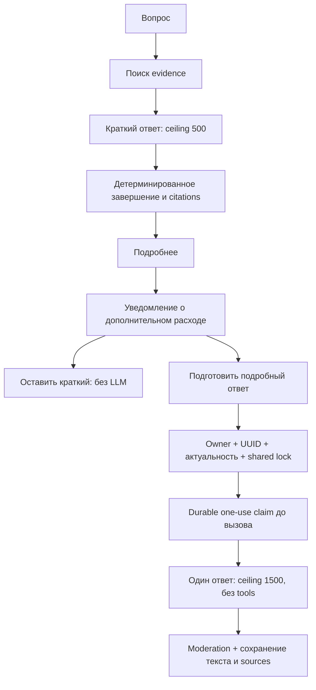

# Единый Telegram agent и retrieval по мануалам

Исправления привязки цитат и полноты ответов 14–15.10.2026, сравнение с сохранённым baseline:
[актуальная оценка Telegram-агента](telegram_agent_evaluation.md).

Модель получает единый массив `evidence`: у каждой записи есть `marker`,
`citation_number`, неизменяемая привязка `source` к chunk/document/page и полный
ограниченный `text`. Номер назначается после объединения источников, поэтому
повторный поиск того же chunk не меняет его страницу или номер. Отдельные
параллельные массивы sources/contexts больше не являются model-facing
контрактом. Публичный API sources сохраняет прежний формат.

При новом уточнении прежние tool-вызовы и результаты исключаются из входа
модели; смысл диалога остаётся. Старые одиночные ссылки очищаются в обычном
тексте, а технические векторы, индексы, код и формулы сохраняются. Исторические
ответы явно помечаются как история, а не новые доказательства.

`citation_evidence` сохраняет полные выбранные фрагменты для expanded, включая
текст после первых 700 символов. При раскрытии они закрепляются в новом
human-сообщении вместе с исходными номерами, независимо от обрезки истории.
Старые checkpoint восстанавливаются по chunk identity из сохранённых tool
контекстов; актуальная явная запись имеет приоритет над исторической.
Output redaction очищает и полные сохранённые доказательства.

Prompt требует сохранять тип модели, режим, условия и субъект исходного факта:
частное утверждение о нагрузке не становится гарантией всех результатов,
а свойство линейной упругости — свойством любой упругости. Семантическое
следование остаётся обязанностью генерации и проверяется отдельной оценкой;
проверка диапазона номера сама по себе его не доказывает. Дополнительного
платного исправляющего вызова LLM нет. Узлы/рёбра графа и confirmation-контракты
не изменены.

В кратком и подробном режимах описание исходного состояния расчёта должно
включать подтверждённый способ его получения и действующие нагрузки.
Название состояния само по себе не заменяет способ; краткость не оправдывает
пропуск причины или условия, необходимого для ответа. Для начального состояния
грунта в стадийном расчёте prompt требует в том же пункте назвать естественные
начальные напряжения и расчёт на действие собственного веса, если это прямо
подтверждено evidence. При отсутствии подтверждения нужен уточняющий поиск.
Ответы не подставляются по номеру вопроса из эталонного набора.

Для общего вопроса об упругом поведении достаточно определения и подтверждённых
классов линейной/нелинейной упругости. Prompt требует завершить ответ после их
получения и не продолжать повторные поиски полного каталога имён моделей.

Запрос обзора явно названной модели достаточен для поиска и ответа. Агент не
должен требовать выбрать аспект или формат; уточнение вместо ответа нужно,
когда объект нельзя определить из текущего сообщения и истории.

Поисковый инструмент получает `query` и полный `english_query` того же вопроса.
Перевод сохраняет все запрошенные свойства, имена моделей и идентификаторы;
добавлять в него ответ запрещено. Исходный standalone-запрос не проходит
повторный condense; его ранжирование остаётся основным. Достаточно содержательный
перевод добавляет не более одного dense-поиска и одного зарезервированного
источника. Для явно смешанных запросов лексическое ранжирование сравнивает
языковые группы отдельно с весом редких терминов; коды и параметры учитываются
в обеих группах. Старые checkpoint-вызовы без перевода совместимы.

Устаревший product-tag замороженного индекса восстанавливается только по
положительным меткам документа или узнаваемому заголовку мануала; известный
другой продукт сохраняет приоритет. CHM-таблицы восстанавливают строки,
пустые ячейки и объединения из исходного HTML. Незавершённые строки и
неоднозначные таблицы не передаются модели. Это не меняет корпус или embeddings.
Бюджет 24 000 символов делится между выбранными источниками и сохраняет целые
предложения/строки. Agent retrieval сохраняет полный выбранный chunk перед
применением бюджета, без окна вокруг первого lexical-совпадения.
Номера страниц английского PDF берутся из заголовка Chapter,
а HTML/CHM не получают вымышленных страниц.
Для вопроса о поведении материала из PDF передаётся явное описание до
плоской таблицы применимости моделей по типам конечных элементов. Её отметки
совместимости не используются как классификация поведения. При вопросе
о применимости к элементам таблица сохраняется.

Итоговый комплект: [указатель](INDEX.md),
[решения и альтернативы](final_technical_documentation.md),
[финальный исполняемый граф](final_agent_graph.md).

Реализовано 2026-10-13. Telegram использует один разговор без `/agent` toggle:
пользователь задаёт вопрос, получает grounded ответ, уточняет его, просит
черновик и при необходимости явно просит отправку. Перед внешним действием
бот показывает точный `chat_id` получателя и полный текст с кнопками
«Подтвердить» / «Отменить».

## Границы реализации

- `app/services/rag.py`: public `retrieve` переиспользует production retrieval
  pipeline (follow-up context, product filters, dense/lexical recall, rerank,
  coverage/confidence gate, deduplication). Возвращает evidence без answer
  generation, с timeout/context budgets и chunk/document/page identity.
- `app/services/agent_persistent.py`: production RAG tool инъецируется лениво;
  knowledge miss (`no_evidence`) отличается от outage (`unavailable`). Нет
  fallback на `data/support_documents.json`. Citation numbers стабильны между
  поисками одного turn; финальный ответ ссылается только на выбранные sources.
- `app/chat/agent.py`: graph adapter с приватным interface/owner/chat thread.
  Пустой graph восстанавливает bounded context из существующей chat history.
- `app/chat/service.py`: тот же turn lock, media extraction, moderation и
  сохранение assistant messages с sources. Approval result также сохраняется.
- `bot`: прежний chat transport/SSE и feedback; added approval callback,
  `/history`, recovery preview при `/start`, полный split длинного текста.

Новых runtime dependencies, model IDs или pricing нет. Настройки ответа: `CHAT_RESPONSE_TOKENS=500`, `CHAT_EXPANDED_RESPONSE_TOKENS=1500`.
`AGENT_CHECKPOINTER=sqlite` — durable local default; production может использовать
existing PostgreSQL saver. Memory saver подходит для offline tests/demo и
не сохраняет pending после перезапуска процесса.

## API

| Операция | Контракт |
|---|---|
| `POST /rag/retrieve` | Authenticated `RAGQuery`; `status`, `question`, `sources`, `contexts`, telemetry; нет `answer` |
| `POST /chats` (Telegram) | Resolve durable owner/interface chat; reuse existing history after bot restart |
| `POST /chats/{id}/messages` | Existing multipart/SSE; final sources и optional `approval` event |
| `GET /chats/{id}/approval` | Exact pending preview или `null` |
| `POST /chats/{id}/approvals/{approval_id}` | JSON `{"approved": true/false}`; canonical result, message ID, sources, optional next approval |
| `DELETE /chats/{id}/messages` | Clear history + agent checkpoint; old buttons become stale |

Approval event/GET содержит только `approval_id`, recipient `chat_id`, `text`.
Recipient и text нельзя переопределить в resume request. Ownership проверяется
до обращения к graph; другой участник группы получает 404. Под тем же chat lock
сравнивается точный draft ID и pending node; stale/repeated callback даёт 409.
Raw `/agent/stream` также требует `approval_id` для resume и не принимает новое
input при pending approval. Telegram не использует административную роль `full`.

Доставка использует сохранённый idempotency key конкретного draft. Graph после
approve/cancel/error завершает turn детерминированным observed tool result;
следующий модельный вызов для утверждения «отправлено» не нужен. Unknown delivery
не отмечается как `sent` и требует проверки у получателя перед новой попыткой.

## Контекст, безопасность и ограничения

История graph ограничена пятью human-turn groups, tool results — 24 записями.
Provider input дополнительно подчиняется `CHAT_CONTEXT_WINDOW` и configured
token budget; удаляются целые human/tool groups, а переполнение текущей группы
даёт явный ответ без LLM call. Default model имеет output cap
`CHAT_RESPONSE_TOKENS` (по умолчанию 500). Production retrieval сохраняет не более пяти выбранных
fragments на вызов, агент ограничивает context 24 000 символами на поиск; бюджет распределяется между выбранными фрагментами, структурные строки не обрываются.

Перед финализацией агент проверяет provider `finish_reason=length`, пустой ответ
и смешение кириллицы/латиницы внутри слова. Детерминированное сокращение сохраняет
законченные предложения, пункты, технические литералы и цитаты, удаляет оборванный
Markdown и дефектную прозу. Дополнительного LLM-вызова для исправления нет.
Заголовки и отдельные обозначения параметров сохраняются только вместе с полным
следующим объяснением, пунктом, блоком кода или строкой таблицы; оборванный хвост
с его заголовком удаляется. Prompt просит писать каждый параметр как
`**обозначение** — смысл` в одном законченном пункте и начинать сразу с ответа.
Truncated tool call не создаёт approval. Метаданные завершения сохраняются.
Уведомление различает сокращение по лимиту длины и удаление дефектного текста.
Оно предлагает «Подробнее» только при доступном brief expansion; иначе отдельный
вопрос о нужном пункте. Формулировка не приписывает неполноту вопросу пользователя.
Текст уведомления сохраняется вместе с ответом.

RAG возвращает фрагменты, а модель формулирует ответ. Prompt требует повторного
поиска и для технических уточнений, ссылку именно на подтверждающий фрагмент,
условия и метку «Пояснение» для выводов сверх прямого текста, отдельные ссылки
при расхождении документов. Citation grounding проверяет номера/наличие sources
и перенумерацию; это не семантическая проверка каждого утверждения. Модель может
нарушить prompt, в том числе пропустить поиск и ответить по истории без источников.
Усиление prompt снижает этот риск, но не является доказательством достоверности.

Кнопка «Подробнее» доступна для последнего краткого ответа с надёжным evidence.
Она сначала показывает уведомление о дополнительном запросе и расходе токенов;
только «Подготовить подробный ответ» запускает отдельную генерацию с ceiling
`CHAT_EXPANDED_RESPONSE_TOKENS` (1 500), `tool_choice=none` и прежними доказательствами.
Неожиданные tool calls отклоняются. Сохраняются исходные номера evidence до
перенумерации brief citations. Недоверенные фрагменты передаются в human data,
фиксированные правила — в system. Отмена и preview не вызывают LLM.

`GET /chats/{chat}/messages/{message}/expansion` возвращает доступность и ceiling;
`POST .../expand` принимает только strict `confirmed: true`. Ownership проверяется
до graph. Под shared turn lock проверяются точный persisted UUID, актуальность,
режим и отсутствие approval. Перед генерацией checkpoint получает одноразовый
claim и result UUID (последние 20 claims). Повтор возвращает сохранённый ответ
или 409 без новой генерации, включая рестарт после сбоя. Expanded/approval/
no-evidence/outage/moderated ответы не предлагают новое раскрытие.
Миграции не нужны: metadata находится в существующем JSON(B) `media_refs`.
Claims не передаются модели; graph и chat storage имеют отдельные транзакции.
Single API worker остаётся эксплуатационным ограничением shared locks.
Токеновый потолок не оценивает стоимость input+output; цены и model IDs прежние.



Raw image bytes не попадают в checkpoint; captions, voice transcripts и
extracted document text проходят прежний media path. Фото без описания
получает прежнюю просьбу добавить текст. Output и exact outgoing draft
проходят moderation. Тексты мануалов считаются недоверенными данными; внешние
действия требуют отдельного подтверждения. Финальные unknown citations
удаляются, sources и feedback сохраняются с конкретным assistant message.

Retrieval timeout не может остановить уже начатый синхронный provider read.
Deadline запрещает следующие retrieval вызовы, а worker остаётся tracked и
держит request-budget lease до фактического завершения, включая disconnect.

Chat repository и graph saver не образуют общую транзакцию. Авария после graph
completion, но до append assistant message, может оставить chat history
отстающей от checkpoint. Идемпотентность доставки обеспечивается существующим
notifier/bot guard, а не общей exactly-once транзакцией всех компонентов.
При неизвестном исходе следует проверить получателя; слепое создание нового
действия может отправить дубликат. Per-chat locks рассчитаны на один API worker;
распределённая сериализация между несколькими API-процессами не добавлена.

## Воспроизводимая offline проверка

Из `HelpDesk_Assistant/` в managed CPython 3.13:

```powershell
.venv/Scripts/python.exe -m pytest tests/chat/test_unified_agent.py tests/test_agent_persistent.py tests/bot tests/chat tests/unit/test_rag.py -q
```

`tests/chat/test_unified_agent.py` проводит полный сценарий через настоящий
FastAPI ASGI transport, `BackendClient`, SQLite checkpoints, scripted model и
production RAG selection с injected retriever. Telegram sender заменён
`AsyncMock`, реальная доставка отсутствует. Проверяются:

1. ordinary question → actual RAG evidence identities → grounded sources;
2. follow-up в том же разговоре и hydration прежней chat history;
3. prepare exact draft → restart bot/backend graph → recover same chat/draft;
4. чужой, stale и повторный callback → отсутствие эффекта;
5. Confirm / Cancel → canonical observed result и persisted message;
6. `/clear` → history/checkpoint deletion и invalidation прежнего approval;
7. real miss, filtered product и unavailable/error без synthetic fallback;
8. несколько поисков с устойчивыми citation numbers;
9. timeout/disconnect worker lease retention, small token budget;
10. media text без raw image payload, полный escaped long preview;
11. public retrieval API без answer generation и с 503 для unavailable.

## Результаты проверки 2026-10-13

Проверка всего накопленного изменения перед публикацией:

- `.venv/Scripts/python -m pytest tests -q` — **740 passed, 11 skipped**.
  Пропуски PostgreSQL contract tests требуют выделенной тестовой БД.
- Differential Ruff по всем 31 изменённым Python-файлам — **0 новых замечаний**:
  15 baseline / 11 current. `git diff --check` — PASS.
- В составе 36 файлов нет `.env`, runtime data/cache или TEMP; `.env` игнорируется,
  сканирование изменённых файлов не обнаружило секретных credential patterns.

Ожидание подтверждённого подробного ответа:

- Полный набор `tests/bot` — **178 passed**; differential Ruff по трём
  затронутым Python-файлам — **0 новых замечаний**; whitespace PASS.
- Exp:y переиспользует общий renderer с одним expand_response и StreamReplace.
  Preview/cancel не запускают ожидание или генерацию; callback ack первым.
  Sources/feedback остаются в последней части без повторного expansion.
- Real aiogram CallbackQuery/Message + локальный clear-on-send BaseSession:
  private/group × short/long, дополнительно HTTP timeout — **6 PASS**. Проверены
  placeholder/typing до результата, drain/newsend/delete ordering, точный footer,
  one backend call, отсутствие оставшихся tasks и error без кнопок. Cancellation
  во время backend wait/drain покрыта dispatcher tests.
- API/state flow, workflow diagram, caps и `.env.example` не менялись.
- Docker build/recreate bot — PASS; тот же six-scenario runtime smoke в новом
  контейнере — PASS. Read-only getMe — PASS, `/ready` 200/ok (Redis/RAG up).
  Backend и datastore container IDs сохранены; live Telegram sends/LLM calls нет.

Уточнение пользователя: typing сохраняется при подготовке и исчезает с ответом:

- `.venv/Scripts/python -m pytest tests/bot -q` — PASS: **172 passed**.
- Differential Ruff по двум изменённым Python-файлам — **0 новых замечаний**;
  whitespace PASS. API/state flow, token caps и `.env.example` не менялись,
  workflow diagram актуальна.
- Реальные aiogram Message + локальный BaseSession, моделирующий typing clear
  только при SendMessage: private/group × short/long — PASS. Во время placeholder
  typing активен; in-flight request завершается до нового body message, после
  него typing выключен, placeholder удалён, полный текст/last-part buttons
  сохранены. Ошибка unchanged edit не дублирует первую часть. Нет live sends/LLM.
- Unit coverage также проверяет отмену во время drain, ошибки send/delete,
  replacement/empty, group reply и fallback без редактируемого placeholder.
- `docker compose build app` и `docker compose up -d --no-deps --force-recreate bot`
  — PASS. Тот же aiogram runtime smoke внутри нового bot-контейнера — PASS во
  всех четырёх сценариях; read-only Telegram getMe — PASS. Backend `/ready`
  200/ok, Redis/RAG up. App и все datastore container IDs сохранены.

Предыдущая проверка статуса (typing отключался; заменено уточнением выше), причины сокращения и атрибуции:

- `.venv/Scripts/python -m pytest tests -q` — PASS: **720 passed, 11 skipped**.
  Профильный набор graph/quality/streaming/burst/expansion/menu — **160 passed**;
  после эквивалентной lint-правки условия graph/expansion — **60 passed**.
- Differential Ruff по шести изменённым Python-файлам — **0 новых замечаний**;
  `git diff --check` — PASS. `.env.example` актуален, caps и публичные контракты
  не менялись; workflow diagram не требует изменений.
- Контейнерный offline smoke — PASS: actual graph/ChatAgent caps 500/1500,
  правильные brief/expanded notices, 0 automatic repair calls. Bot renderer
  с `StreamReplace` использует один editable placeholder, 0 typing calls и
  0 pending tasks; no live sends. Ошибки/отмена/fallback покрыты unit tests.
- Docker build/recreate `app bot` — PASS; `/ready` внутри app: 200/ok,
  Redis/RAG up. PostgreSQL/Qdrant/Redis/Phoenix container IDs сохранены.
  Read-only Telegram `getMe` — PASS; реальных сообщений не отправляли.
- Read-only metadata/manual diagnostic: прежний длинный ответ имел length stop
  и не вызывал новый поиск; ответ по m вызывал поиск. Диапазон/рекомендации были
  в CHM evidence, а итоговая ссылка указывала PDF. Проверка номеров источников
  не обнаруживает такую семантическую ошибку; уточнение prompt не гарантирует
  её устранения во всех будущих ответах. Чужие данные во внешнюю LLM не отправлялись.

Сохранение обозначений параметров и структуры длинного ответа:

- `.venv/Scripts/python.exe -X utf8 -m pytest tests -q` — PASS:
  **709 passed, 11 skipped**; профильный набор compaction/graph/expansion/bot —
  **108 passed**. Differential Ruff — **0 новых замечаний**; whitespace — PASS.
- Воспроизведение: `### E50ref`, `### Eoedref`, `### Eurref` сохраняются с
  законченными пояснениями; одинокий заголовок и оборванный диапазон `m`
  удаляются. Проверены numbered/bold/code labels, decimal formulas, таблицы,
  Markdown внутри code и неизменность полного текста при Telegram chunking.
- Docker build/recreate `app bot` — PASS, datastore containers сохранены.
  SDK HTTP-stub runtime — PASS: параметрические заголовки сохранены после
  length-stop, caps 500/1 500, extra repair calls 0. Renderer runtime — PASS:
  heading/body пары, literal text и кнопки на последней части. `/ready`: `ok`,
  Redis/RAG `up`, Telegram API доступен. Реальных LLM-вызовов и Telegram-отправок нет.

Предыдущая проверка экономной политики и подтверждённого раскрытия:

- `.venv/Scripts/python.exe -X utf8 -m pytest tests -q` — PASS:
  **691 passed, 11 skipped** (PostgreSQL contract tests требуют отдельной БД).
- `tests/test_async_llm.py` — PASS: **7 passed**. Нестабильное сравнение времени
  заменено прямым измерением перекрытия вызовов и ограничения concurrency;
  два предшествующих полных прогона падали только на старом timing assertion.
- `.venv/Scripts/python.exe -X utf8 -m pytest tests/bot/test_expansion.py tests/bot/test_admin_feedback.py tests/chat/test_expansion.py tests/unit/test_answer_quality.py tests/chat/test_unified_agent.py tests/test_agent_persistent.py tests/chat/test_service_context.py -q`
  — PASS: **132 passed** (offline, mocked provider/Telegram transport).
- Differential Ruff: **11 baseline, 11 current, 0 новых замечаний**;
  `git diff --check` — PASS.
- Проверены strict consent, preview/cancel без LLM, caps/context reservation,
  owner/group isolation, shared-lock concurrency, SQLite restart/failure,
  clear, исходные citation IDs, trust boundary evidence и aiogram Dispatcher.
- Docker build/recreate `app bot` — PASS, контейнеры данных сохранены.
  Runtime smoke SDK с HTTP stub — PASS: реальные request caps 500/1 500,
  ноль дополнительных вызовов для compaction, `tool_choice=none` при раскрытии;
  `/ready`: `ok`, Redis/RAG `up`. Внешних LLM-вызовов и отправок в Telegram нет.
- Общий production aiogram router + admission runtime smoke — PASS:
  cost panel, preview/cancel (0 generation calls), confirm (1 mocked call),
  denied user. Telegram API доступен; реальные сообщения не отправлялись.

Историческая проверка прежней политики 2 000 + repair (заменена DEC-2026-10-13-004):

- `.venv/Scripts/python.exe -X utf8 -m pytest tests -q` — PASS:
  **672 passed, 11 skipped** (PostgreSQL contract tests требуют отдельной БД).
- Профильный набор `tests/unit/test_answer_quality.py`,
  `tests/test_agent_persistent.py`, `tests/chat/test_unified_agent.py`,
  `tests/chat/test_service_context.py` — PASS: **92 passed**.
- Differential Ruff по затронутым Python-файлам — **0 новых замечаний**;
  `git diff --check` — PASS.
- Docker build/recreate `app bot` — PASS; `/ready`: `ok`, Redis/RAG `up`.
  Идентификаторы контейнеров данных не изменились. Runtime smoke в контейнере
  с реальными LangChain/OpenAI SDK и HTTP stub — PASS: cap 2 000,
  `tool_choice=none` при repair, сохранённый `finish_reason=stop` и обозначения.
  Внешних LLM-вызовов и Telegram-отправок в smoke нет. Повторная отправка
  сохранённого диалога внешнему провайдеру не выполнялась: auto-review отклонил
  чувствительный egress.

Первоначальная проверка объединения RAG/agent (до меню и исправления ответов):

- `.venv/Scripts/python.exe -X utf8 -m pytest tests -q` — PASS:
  **628 passed, 11 skipped** (PostgreSQL repository checks требуют
  `CHAT_TEST_DATABASE_URL`). Полный прогон включает исправления восстановления
  текущего сообщения из истории и объединения источников параллельных tools.
- После финального исправления буквального отображения Markdown в exact
  preview: `.venv/Scripts/python.exe -X utf8 -m pytest tests/chat/test_unified_agent.py tests/bot -q`
  — PASS: **125 passed**. Подтверждаемый текст сохраняет `**` и backticks;
  HTML-символы экранируются, полный текст не обрезается.
- Ruff по полному набору правил, сравнение с `HEAD` — PASS: **0 новых
  замечаний**. Общий запуск `ruff check --select F,I` по изменённым файлам
  сообщает два существовавших `I001` в imports `app/services/rag.py` и
  `tests/unit/test_rag.py`; этот baseline не очищался массовым рефакторингом.
- `git diff --check` — PASS.

На Windows сетевые ограничения песочницы блокировали создание локального
`asyncio.socketpair` до выполнения тестов. Проверки выполнены вне песочницы;
LLM и Telegram actions в сквозном тесте заменены заглушками.

Live LLM, Telegram delivery и новый Docker smoke для этого изменения не
запускались. Офлайн-тесты проверяют integration contracts и ограничения, но
не заменяют проверку качества выбранной runtime модели на реальных запросах.
